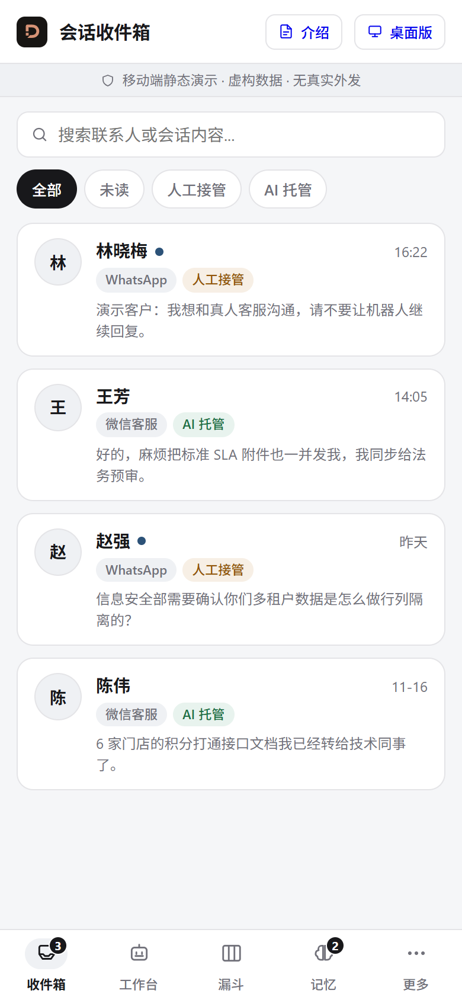
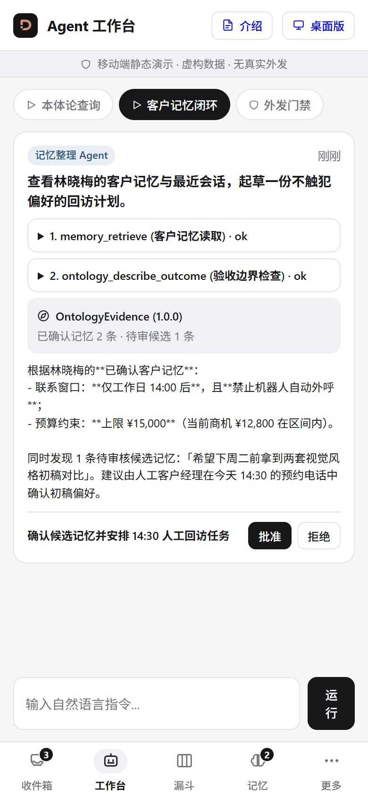
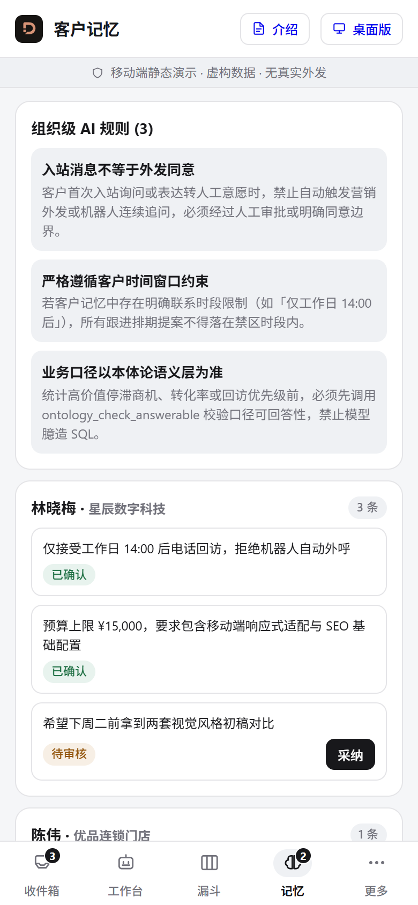

<div align="center">

# Pi Native CRM

**面向跨境客户经营的 Agent 原生 CRM**

让 Agent 基于客户会话、商机和已确认记忆推进跟进，让负责人查看执行依据、审批动作与 CRM 状态变化。

**[打开移动端在线演示](https://crm.helson.top/mobile)** · [快速开始](#快速开始) · [Agent 架构](docs/architecture/README.md) · [服务接入](docs/integrations/agent-services.md)

</div>

## 在线演示

打开演示后选择 **先看看演示 → 工作台 → 客户记忆闭环**。以一次客户回访为例，查看 Agent 怎样读取已确认的联系时段和预算，识别待审核的记忆，并提出需要人工批准的回访任务。

| 会话收件箱 | Agent 工作台 | 客户记忆 |
| :---: | :---: | :---: |
|  |  |  |
| 查看会话与接管状态 | 查看工具调用和待审批动作 | 查看组织规则与客户约束 |

截图来自在线移动端演示。页面使用虚构数据，操作不会发送真实消息。

## 核心功能

### Agent 工作台

- 选择内置 Agent 和目标 CRM 对象，以自然语言发起只读调查或行动任务。
- 在同一条时间线上查看上下文、决策、工具调用、Observation 和状态变化。
- 查看模型绑定、Token 用量、工具次数、预算与终止原因。
- 通过持久化事件和 SSE 续读，在刷新后回放执行过程。

### 四个内置 Agent

| Agent          | 职责                                                          |
| -------------- | ------------------------------------------------------------- |
| CRM 情报员     | 汇总客户、历史会话、商机、知识与记忆，形成带证据的客户画像    |
| 销售运营 Agent | 排查停滞商机、更新字段、调整阶段、安排后续跟进                |
| 客户沟通 Agent | 结合会话和知识起草回复，核对承诺依据，提出转人工动作          |
| CRM 主管 Agent | 跨漏斗、任务和执行记录调查异常，组织专职 Agent 协作并汇总结果 |

组织预装内置 Agent，并提供可直接选择的场景任务。内置原件保持锁定，通过“复制并定制”创建自己的 Agent；原件跟随组织默认模型，副本固定创建时的模型配置。

### 受控执行 Harness

- Agent 的 CRM 读写经过工具端口，权限、组织作用域和目标范围贯穿执行。
- 按读取、可逆写入、外部动作和不可逆动作分类管理工具。
- 自动执行读取与具备业务补偿能力的写入，对外动作通过人工确认。
- 保存字段差异、审计记录和撤销动作，将批准后的工具结果带回后续执行。
- 支持暂停、恢复、取消、执行租约、重试和累计预算控制。

### 多 Agent 与商机 Mission

- 主管 Agent 组织只读专职 Agent 调查，使用父子 Run 保存各自的上下文与结果。
- 独立调查支持并行执行，父 Run 统一管理业务写入和预算。
- 商机 Mission 保存目标、验收条件、截止时间和跨运行进度。
- 将客户回复、内部协作回复和负责人补充方向接入任务续跑。
- 通过结构化结果、证据核验与方向版本，关联任务判断和 CRM 动作。

### 知识与记忆

- 本地 RAG 与 WeKnora Wiki 检索接口，为回答提供知识来源、页面版本与引用。
- 联系人事实经人工确认后进入 CRM 记忆，供后续会话和任务消费。
- Mem0 接入检索排序、记忆同步、删除与清理回执。
- 组织记忆、客户记忆、知识材料和运行历史分层管理，SQL 保持业务事实源。
- 组织 Skill、版本和参考资料加载接口，为 Agent 提供领域能力。

### Eval 与可观测性

- 围绕任务结果、证据、工具可靠性、策略遵守和记忆覆盖进行评测。
- 结合确定性检查、真实模型语义评审与回归样例，保存评分依据。
- Langfuse 接收模型与工具边界的 Trace、用量和 Eval 分数。
- 通过持久化投递队列、去重与重试关联 CRM Run 和外部观测记录。
- 在工作台回看真实模型录制、工具调用及评测结果，复用脱敏验证样例。

## 工作原理

```text
自然语言任务 + CRM 对象
          │
          ▼
上下文构建：CRM · Wiki · Memory · Skills · 历史 Run
          │
          ▼
Pi Agent Loop ◄────────────── 工具结果 / 人工确认
          │                              ▲
          ▼                              │
Harness：权限 · 范围 · 策略 · 预算 · 审批 · 恢复
          │                              │
          ▼                              │
CRM 工具端口 ───────► 业务操作 ───────► Observation
          │
          ▼
CRM 状态变化 + Run Events + Trace + Eval
```

CRM 产品层通过自有接口调用运行内核；Pi 类型封装在适配层中。CRM 数据库保存业务事实，Run、事件与检查点保存执行状态。知识和记忆提供依据，工具负责动作，评测负责反馈。

## 灵活集成

- **模型**：组织级真实凭据、默认模型绑定、固定模型版本，以及 OpenAI、Anthropic、Google 和兼容模型接口。
- **Memory**：Mem0 客户记忆适配器，与 CRM 确认事实、同步队列和生命周期管理衔接。
- **LLM Wiki**：WeKnora 知识检索与来源接口，与本地 RAG、组织知识权限衔接。
- **Trace / Eval**：Langfuse 项目绑定、OTLP Trace 和评测分数投递。
- **WhatsApp**：WAHA 会话与消息工具，将客户沟通纳入审批和审计。
- **飞书内部协作**：企业身份映射、成员绑定、消息队列、回复关联与任务续跑接口。

第三方服务按组织绑定和启用，接入配置由服务端管理。模型凭据与服务凭据在服务端保管，不写入运行事件或提交记录。

## 快速开始

### 本地开发

准备 Node.js 22+、pnpm，以及开发用 Supabase 和 Redis 配置。

```bash
git clone https://github.com/luckiest-draw/AiNativeCrm.git
cd AiNativeCrm
pnpm install --frozen-lockfile

# 仅在配置文件不存在时创建，保留已有配置
test -e .env.local || cp .env.example .env.local
test -e .env || touch .env
```

按照 [开发配置指南](docs/SETUP.md)填写 Supabase、Redis、应用地址及服务端加密配置；新开发数据库按指南初始化。已有数据库按迁移流程更新。

在不同终端中启动：

```bash
# Web
pnpm dev --port 3000

# Agent 执行进程
pnpm worker

# 本地辅助调度
pnpm dev:crons
```

打开 [本地工作台](http://localhost:3000/app/ai/workbench)，登录后在组织模型配置页绑定真实模型凭据，选择内置 Agent、CRM 对象和任务开始运行。

Mem0、WeKnora 与 Langfuse 的本地服务部署和组织绑定，见 [本地服务指南](infra/local-agent-services/README.md)与[接入契约](docs/integrations/agent-services.md)。

### 本地演示与真实运行回放

```bash
node scripts/serve-agent-demo.mjs
```

打开 [本地演示工作台](http://127.0.0.1:3008/#/app/ai/workbench)。这里可以体验合成 CRM 场景，并回看脱敏的真实模型输入输出、工具调用、记忆、知识引用与评测。回放读取历史记录，演示页面独立于 CRM 后端运行。

### 常用命令

| 命令                             | 用途                         |
| -------------------------------- | ---------------------------- |
| `pnpm dev`                       | 启动开发 Web 服务            |
| `pnpm worker`                    | 启动 Agent 执行进程          |
| `pnpm dev:crons`                 | 启动本地辅助调度             |
| `pnpm ai:agents:ensure-builtins` | 为已有组织幂等补齐内置 Agent |
| `pnpm typecheck`                 | 类型检查                     |
| `pnpm lint`                      | 代码检查                     |
| `pnpm test:unit`                 | 单元测试                     |
| `pnpm test:db`                   | 数据库不变量与隔离检查       |
| `pnpm test:e2e`                  | 浏览器测试                   |
| `pnpm test:e2e:acceptance`       | 专项验收测试                 |
| `pnpm test:e2e:live`             | 真实模型场景测试             |
| `pnpm build`                     | 构建应用                     |

### 助手指南（可选）

`.agents/skills/` 里的指南只在仓库内生效。要把它们链接到全局、让任意目录下的 CLI 都能用：

```bash
bash scripts/instalar-guias.sh           # 安装或更新（从 main 拉取）
bash scripts/instalar-guias.sh --remover # 撤销
```

装好后新开一个 CLI 会话即可。Claude Code 里输入 `$pi-native-instalar` 调用安装指南；Windows 未开启开发者模式时会自动改用复制，不再依赖符号链接。

## 项目状态

当前为内部研发版本，主分支围绕 Agent 工作台、受控 CRM 工具、多 Agent 协作、商机 Mission、知识记忆和 Eval 持续迭代。

- **真实运行记录**：已沉淀真实模型、多 Agent、Mem0 / WeKnora / Langfuse 联调与脱敏回放。[查看运行记录](docs/testing/agent-services-real-run-2026-10-03.md) · [查看三服务联调](docs/testing/local-agent-services-connected-2026-10-03.md)
- **系统复验记录**：2026-10-03 完成单元测试、数据库不变量、关键浏览器场景及真实模型复验。[查看复验报告](docs/testing/system-acceptance-fixes-2026-10-03.md)
- **工程复核记录**：2026-10-05 类型检查、lint、构建与全量单测通过，单测 1,324 个文件、12,958 项通过。[查看工程复核](docs/testing/repository-hygiene-2026-10-05.md)

执行记录用于证明实际链路，业务结果由证据与验收条件核验；详细测量范围保存在对应报告中。

## 技术与目录

基于 Next.js、React、TypeScript、Tailwind CSS、Supabase、Pi Agent Core / Pi AI，以及 Vitest、Playwright 构建。

| 目录                  | 内容                                              |
| --------------------- | ------------------------------------------------- |
| `app/`、`components/` | CRM 页面、Agent 工作台与产品 API                  |
| `lib/`                | CRM 领域逻辑、工具、Harness、知识记忆与服务适配器 |
| `workers/`            | 后台 Agent 执行                                   |
| `supabase/`           | 数据库基线、迁移与权限规则                        |
| `infra/`              | 服务部署与接入配置                                |
| `tests/`              | 单元、数据库与浏览器测试                          |
| `examples/`           | 演示场景与回放入口                                |
| `docs/`               | 架构、规格、配置与验证记录                        |
| `evidence/`           | 文档引用的验证证据                                |

本地输出放在 `output/`、`tmp/` 或 `scratchpad/`，历史交接放在 `docs/handoffs/`。环境文件、真实凭据、客户数据和数据库备份不进入版本库。

## 文档

- [文档入口](docs/index.md)
- [Agent 架构](docs/architecture/README.md)
- [商机 Mission 与执行状态](docs/architecture/mission-state.md)
- [飞书内部协作接口](docs/architecture/internal-collaboration-feishu.md)
- [Memory、Wiki 与 Langfuse 接入](docs/integrations/agent-services.md)
- [本地服务启动与联调](infra/local-agent-services/README.md)
- [专项 E2E 测试入口](tests/e2e/configs/README.md)

内部开发先阅读 [AGENTS.md](AGENTS.md)与[CLAUDE.md](CLAUDE.md)。本项目包含继承代码，遵循 [MIT 许可及原版权声明](LICENSE)。
